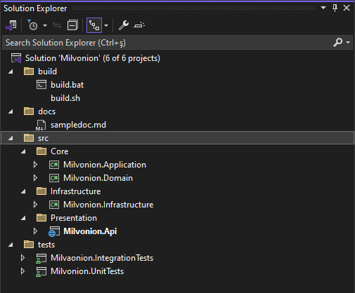
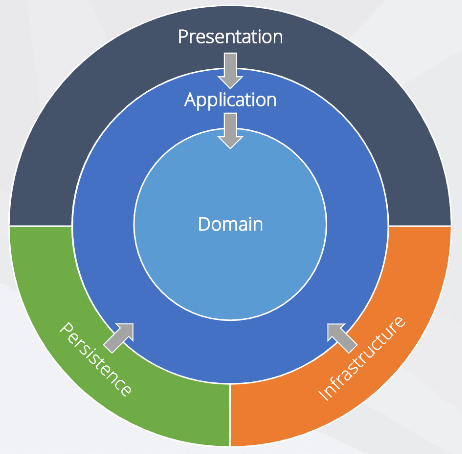
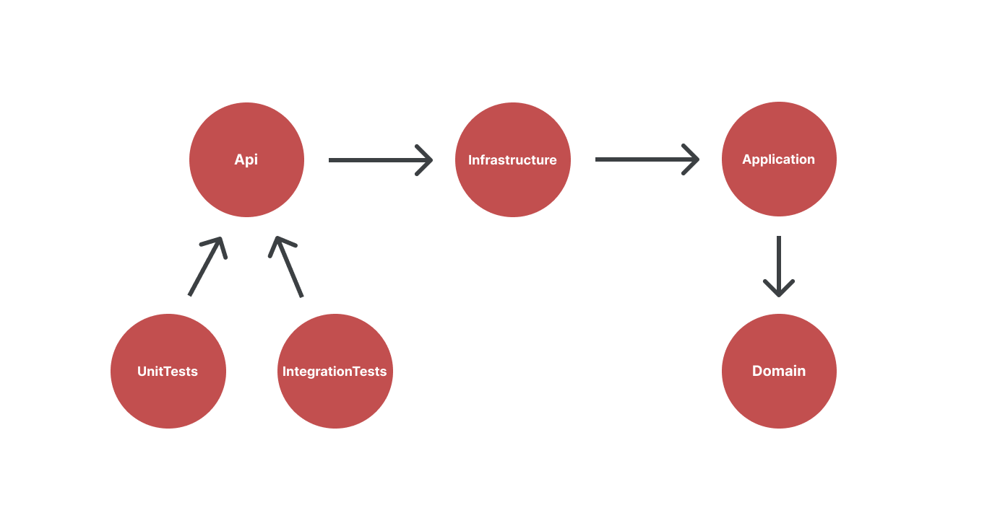

# Storeasy Api

This document is a guide to what you need to know about the project.

## Tech Stack

- .Net 10
- PostgreSql
- Redis (cache, token revocation stamps, feature flags, rate limits)
- Serilog (Console, Seq, OpenTelemetry)
- OpenTelemetry (metrics and traces over OTLP)
- Docker

## Requirements

| Requirement | Needed for | Notes |
|---|---|---|
| .NET 11 SDK | build, run, tests | `global.json` selects Microsoft.Testing.Platform for `dotnet test`. |
| Visual Studio 2022 17.13+ / Rider | IDE | The solution is a `.slnx` file. |
| PostgreSql (17 recommended) | the application database | Any reachable server; `docker-compose.yml` runs one locally. |
| Redis (7) | required at runtime | Shared state of every instance; `docker-compose.yml` runs one locally. |
| Seq | logs when `MILVA_ENV` is `test` or `prod` | Optional locally; `docker-compose.yml` runs one (`SeqUri=http://localhost:5341`). |
| OpenTelemetry collector | logs, metrics, traces when `MILVA_ENV=prod` | Optional; nothing is exported while `OpenTelemetry:CollectorUrl` is empty. |
| Docker | local dependencies, integration tests, images | The integration tests start PostgreSql and Redis with Testcontainers. |

## Getting Started

### 1. Local dependencies

Redis is required: the `[Cache]` interceptor, the token revocation stamps, the feature flag cache and the rate limit counters live there, so every instance shares them. `docker-compose.yml` runs Redis and, optionally, PostgreSql and Seq for local development:

```
docker compose up -d
```

`Milvasoft:Caching:Redis:ConnectionString` defaults to `localhost:6379` (host:port of the Redis endpoint). Every key the application writes is built by `CacheKeys` (`Application/Utils/Helpers`) as `{CacheKeys:Prefix}:{key}` (`sstamp:{userId}`, `rl:{bucket}:{scope}:{window}`, `feature-flags-disabled`) and the `[Cache]` interceptor hashes the same prefix into its keys, so two applications on one Redis (an API and its admin API, two environments) never share an entry; Milvasoft's Redis options have no key prefix of their own. Add a new key to `CacheKeys`, never as a literal at the call site. A service that must touch another application's keys on purpose (an admin API revoking the main API's users) builds a second `CacheKeys` with that application's prefix. The connection is lazy and retries in the background: the application starts while Redis is down, the rate limits fail open, the revocation check and the feature flags fall back to the database and the readiness probe reports 503.

### 2. Configuration

| Key | Environment variable | Description |
|---|---|---|
| `ConnectionStrings:DefaultConnectionString` | `ConnectionStrings__DefaultConnectionString` | PostgreSql connection string. Empty in `appsettings.json`; `dotnet new storeasy --PostgreConnectionString ...` writes the local one into `appsettings.Development.json` only. |
| `Milvasoft:Caching:Redis:ConnectionString` | `Milvasoft__Caching__Redis__ConnectionString` | Redis endpoint as `host:port` (default `localhost:6379`). |
| `CacheKeys:Prefix` | `CacheKeys__Prefix` | Prefix of every Redis key of the application (default: the project name in lower case). Applications that share one Redis need different prefixes. |
| `SeqUri` | `SeqUri` | Seq server url (e.g. `http://seq:5341`). Empty disables Seq. |
| `OpenTelemetry:ServiceName` | `OpenTelemetry__ServiceName` | Service name of the logs, metrics and traces. |
| `OpenTelemetry:CollectorUrl` | `OpenTelemetry__CollectorUrl` | OTLP gRPC endpoint of the collector (e.g. `http://otel-collector:4317`). Empty disables OpenTelemetry. |
| `Milvasoft:Identity:Token:SymmetricPublicKey` | `Milvasoft__Identity__Token__SymmetricPublicKey` | Secret. HMAC-SHA256 signing key of the access tokens (at least 32 characters), see [Secrets](#secrets). |
| `Milvasoft:FileOperations:Json:EncryptionKey` | `Milvasoft__FileOperations__Json__EncryptionKey` | Secret. AES key of Milvasoft's encrypted JSON file operations (exactly 16, 24 or 32 characters); only read once a project adds `Milvasoft.FileOperations`. |
| `Storeasy:Registration:Mode` | `Storeasy__Registration__Mode` | Who may register: `Open` (default), `InviteOnly` (a valid organization invitation for the same e-mail is required and accepted) or `Closed`. |
| `Storeasy:App:BaseUrl` | `Storeasy__App__BaseUrl` | Public address of the web app; e-mail links point at `{BaseUrl}/verify-email`, `/reset-password` and `/invitation` with a `token` query value. Required outside Development. |
| `Storeasy:Email:Provider` | `Storeasy__Email__Provider` | `Smtp` (self-host), `Notifike` (Milvasoft hosting) or `Log` (Development only: writes the e-mail and its link to the log). |
| `Storeasy:Email:FromName` | `Storeasy__Email__FromName` | Sender display name. |
| `Storeasy:Email:Smtp:Host`, `Port`, `UserName`, `From`, `EnableSsl` | `Storeasy__Email__Smtp__Host` ... | SMTP server; `Host` and `From` are required with the `Smtp` provider outside Development. |
| `Storeasy:Email:Smtp:Password` | `Storeasy__Email__Smtp__Password` | Secret. SMTP password. |
| `Storeasy:Email:Notifike:BaseUrl` | `Storeasy__Email__Notifike__BaseUrl` | Notifike API base address (`POST {BaseUrl}/notifications/send`). |
| `Storeasy:Email:Notifike:ApiKey` | `Storeasy__Email__Notifike__ApiKey` | Secret. Notifike API key (`X-Api-Key` header). |
| `Storeasy:Jobs:Enabled`, `Workers`, `PollIntervalMilliseconds`, `LeaseSeconds`, `DefaultMaxAttempts`, `RetryBaseDelaySeconds`, `RetryMaxDelaySeconds` | `Storeasy__Jobs__...` | Store job runner: whether this instance runs jobs, parallel jobs per instance, idle poll pause, lease of a running attempt (renewed on every step), attempts and the exponential retry backoff. |
| `Storage:S3:Bucket`, `Region`, `ServiceUrl`, `ForcePathStyle`, `PresignedUrlLifetimeMinutes` | `Storage__S3__...` | Private S3 compatible bucket for files (presigned URLs only). Empty bucket disables uploads (503). `ServiceUrl` + `ForcePathStyle` for MinIO; empty `ServiceUrl` for AWS S3. |
| `Storage:S3:AccessKey`, `Storage:S3:SecretKey` | `Storage__S3__AccessKey`, `Storage__S3__SecretKey` | Secret. Bucket credentials; without an access key the AWS default credential chain is used. `appsettings.Development.json` carries only the local MinIO defaults of `docker-compose.yml`. |
| - | `MILVA_ENV` | `dev`, `test` or `prod`, see [Environment](#environment-milva_env). |

#### Secrets

The appsettings files carry no secret: the signing key and the encryption key are empty, and the connection string is only in `appsettings.Development.json` (a local value). Secrets come from user secrets on a developer machine and from environment variables everywhere else. `dotnet new storeasy` gives every generated project its own `UserSecretsId`, so two projects never share a user secrets store. Set the local values once (run in the solution root; `openssl rand -hex 32` prints 64 random hex characters, in PowerShell use `[Convert]::ToHexString([Security.Cryptography.RandomNumberGenerator]::GetBytes(32))`):

```
dotnet user-secrets set "Milvasoft:Identity:Token:SymmetricPublicKey" "$(openssl rand -hex 32)" --project src/Storeasy.Api
dotnet user-secrets set "ConnectionStrings:DefaultConnectionString" "Host=localhost;Port=5432;Database=storeasy;Username=postgres;Password=..." --project src/Storeasy.Api   # optional, overrides appsettings.Development.json
dotnet user-secrets list --project src/Storeasy.Api
```

The startup checks the signing key before the identity services read it (`EnsureTokenSigningKey`):

- outside Development (`ASPNETCORE_ENVIRONMENT` is not `Development`, e.g. the production image) a missing key or one shorter than 32 characters stops the application with a message that names `Milvasoft__Identity__Token__SymmetricPublicKey`, so a container never runs with a known or empty key;
- in Development a random key is generated for the run and a warning is written to the console, so a fresh clone and `dotnet ef` start without setup. Tokens issued with a generated key stop working when the application restarts; set the user secret above to keep them.

The integration tests give the key (and the connection strings) through environment variables (`StoreasyApiFactory`). Keep every new secret (provider keys, passwords) out of the committed files the same way: an empty value with a comment in `appsettings.json`, user secrets locally, environment variables in the containers.

### 3. First migration

The template ships without migrations. Create the initial one in the generated project before the first run (the migrations assembly is the Api project):

```
dotnet tool install --global dotnet-ef --version 11.0.0-rc.3.*
dotnet ef migrations add InitialCreate --project src/Storeasy.Api
```

The dotnet-ef version follows the Entity Framework Core packages of the template (11.0.0-rc.3, pinned by Npgsql.EntityFrameworkCore.PostgreSQL). `InitialCreate` includes the `Users.SecurityStamp` column of the Milvasoft 11 `MilvaUser` (user tokens and 6 digit codes are bound to it; `IMilvaUserManager` rotates it when the password, email or phone number changes).

`MigrationHostedService` applies pending migrations on every startup (before the background jobs start), creates the missing feature flag rows, then loads the language and permission lists. Add a migration for every model change (`dotnet ef migrations add <Name> --project src/Storeasy.Api`).

A project generated from an earlier template version (Milvasoft 10) needs, after the package update:

- `dotnet ef migrations add AddUserSecurityStamp --project src/Storeasy.Api` (adds the nullable column; do not backfill it, a null stamp keeps the tokens issued before the update valid);
- if `Users.NormalizedUserName` / `NormalizedEmail` (or other `MilvaNormalize` columns) contain `ı` or `İ`: a migration that folds them to `I` the way `MilvaNormalize` does now, skipping rows whose new value would collide with an existing row (unique indexes);
- no `Milvasoft:Identity:Password:Hasher:IterationCount` in the appsettings: the library default (PBKDF2-SHA512, 210000 iterations) applies, and the login upgrades older hashes (`CheckPassword(user, password, out rehashNeeded)` + `RehashPassword`).

### 4. Run

```
dotnet run --project src/Storeasy.Api
```

The API documentation (Scalar) is at http://localhost:5000/api/documentation. In Development the startup also reports the localization keys that are missing from a resx file (`MissingResxKeyFinder`).

### 5. Initial data

`POST /api/v1.0/developer/database/init` seeds the root user, the super admin role, permissions, languages, UI data and the seed protection triggers, and returns the generated root password. `database/seed` seeds the same with development data: the root user, `admin` (Manager, SuperAdmin role) and `viewer` (AppUser, a `Viewer` role with every list permission), all with the password `Dev12345!` (`DeveloperService.DevelopmentPassword`, valid under the default password policy). The seed reports the first failing step (e.g. a password a stricter policy rejects) instead of success. Every developer endpoint requires a super admin token and is disabled when `MILVA_ENV=prod` (the Scalar UI sends a super admin token).

The documentation token is the root user's (id 1) and carries its current revocation stamp, built each time the page is served. Before the root user exists the stamp cannot be validated, so only `database/init` and `database/seed` (`[SkipSessionStampValidation]`; each one runs only on an empty database) accept it; reload the documentation page after seeding to get a token that works everywhere.

### First production database

The production image sets `MILVA_ENV=prod`, so the developer endpoints (and `database/init`) are closed there. Initialize a new production database once, from a non-production environment pointed at it:

1. Deploy the image (or run the API once) against the empty database: `MigrationHostedService` applies the migrations (the `InitialCreate` migration must exist).
2. On a developer machine, run the API with `MILVA_ENV=dev` and `ConnectionStrings__DefaultConnectionString` set to the production database.
3. Open the documentation page and call `POST /api/v1.0/developer/database/init` with its token. Store the returned root password; it is generated once and never shown again (`init` refuses an initialized database).
4. Stop the local API. From now on only `MILVA_ENV=prod` instances use that database.

The seeded system rows (ids below 21 of `Users`, `Roles`, `Permissions`, `Languages`) are protected by database triggers; every other table starts its ids at 1.

### Environment (`MILVA_ENV`)

| Value | Logs | Notes |
|---|---|---|
| `dev` | Console | Local development. |
| `test` | Seq (`SeqUri`) | Console when `SeqUri` is empty. |
| `prod` | OpenTelemetry collector (`OpenTelemetry:CollectorUrl`) + Seq (`SeqUri`) | Developer endpoints and the API documentation are disabled. Console when both are empty. Set by the production `Dockerfile`. |
| not set / other | Console | Treated as non-production: always set `MILVA_ENV=prod` in production. |

Metrics and traces are exported over OTLP (gRPC) only when `OpenTelemetry:CollectorUrl` is set. The application database never receives logs: requests, exceptions and `[Log]` method logs go to the Serilog sinks above.

### Method logs (`[Log]`)

`Milvasoft:Interception:Log:LogDefaultParameters` is `false` in both appsettings files. With `true`, Milvasoft's log interceptor writes the namespace, class, method, every argument (the whole request) and the whole result of each `[Log]` method; with `false` it writes none of them and `StoreasyDbLogger` drops the empty entry, so `[Log]` costs nothing until it is switched on. The default is off because the arguments and results are personal data (names, e-mails, phone numbers) and can be secrets: the interceptor masks only `string` properties marked `[LogMasked]` (the template marks the passwords of `LoginCommand`, `CreateUserCommand` and `ChangePasswordCommand` and `RefreshLoginCommand.RefreshToken`), it cannot mask an `UpdateProperty<string>` (`UpdateUserCommand.NewPassword`) or a token object (`LoginResponseDto.Token`), and a new property that someone forgets to mark would leak silently. Dump, where this setup comes from, runs with `true` and depends on that marking; the template takes the safe side and leaves the decision to the project (for example `true` only in a development environment). When you turn it on:

- mark every password, token, secret or one-time code of a request with `[LogMasked]` (`LogMaskingTests.SensitiveStringPropertiesOfRequests_ShouldBeLogMasked` fails otherwise);
- keep `[Log]` off a handler whose request or result carries a secret that is not a plain string (`LogMaskingTests.LoggedHandlers_ShouldNotCarryUnmaskableSecrets`); this is why the login, refresh, change password and user create/update handlers have no `[Log]`.

### Docker images

Both images are built from the solution root (the `.dockerignore` applies):

```
docker build -t storeasy-api .                        # production: chiseled runtime, MILVA_ENV=prod, port 8080
docker build -t storeasy-api:dev -f Dockerfile-dev .  # development / test: runtime with a shell, MILVA_ENV set at run time
```

```
docker run -p 8080:8080 \
  -e ConnectionStrings__DefaultConnectionString="Host=...;Database=...;Username=...;Password=..." \
  -e Milvasoft__Caching__Redis__ConnectionString=redis:6379 \
  -e Milvasoft__Identity__Token__SymmetricPublicKey="<64 random characters>" \
  -e SeqUri=http://seq:5341 \
  -e OpenTelemetry__CollectorUrl=http://otel-collector:4317 \
  storeasy-api
```

The Visual Studio container profile builds `Dockerfile-dev`.

### Conventions

- Handlers return the response envelope; the HTTP status code comes from the message key (`Storeasy.Api/Utils/ResponseStatusCodes.cs`). Unknown keys are 400. When a new message key is not a 400, add it to that table (and the key to both `tr-TR` and `en-US` resx files).
- Authorization is deny-by-default: every endpoint requires an authenticated user unless it is marked with `[AllowAnonymous]`. Unknown urls return a 404 envelope.
- Access tokens carry the user id (`uid`) and a revocation stamp (`sstamp`). Every authenticated request compares the stamp with the user's current one (Redis, database fallback) and a mismatch or a missing stamp is a 401. Password change, an admin password reset, a role change, a lock and a deletion rotate the stamp (after the commit), so the user's tokens die at once; refresh tokens are single use.
- Access tokens are bound to this API: `Milvasoft:Identity:Token:TokenValidationParameters` validates the issuer and the audience (`ValidIssuer` / `ValidAudience`, the project name by default). Another service that signs with the same key (e.g. an admin API generated as `{Project}Hub`) mints tokens with its own issuer and audience, so its tokens are rejected here (401) and the other way round. Change both values together; they are written into every token at login.
- Handlers read the caller from `ICurrentUser` (id, user name, type from the validated token), never from an id in the request.
- Length limits of a field live on the entity (e.g. `User.NameMaxLength`) and the create and update validators use the same constant.
- A handler that does external work (cache, mail, notifications) keeps only its database writes transactional with `ITransactionRunner.RunAsync` and does the external work after it returns, instead of a handler-wide `[Transaction]`. Interceptable services such as the runner are registered before `AddMilvaInterception`.
- Expensive or anonymous endpoints get `[RateLimit(limit, windowSeconds, "<stable-bucket-name>")]` (per user, per client address on anonymous endpoints; 429 with `Retry-After` when exceeded; fails open without Redis). Login allows 10 and refresh 30 requests per minute.
- A create endpoint whose record has no natural uniqueness gets `[Idempotent]` (e.g. `POST roles/role`): a client sends the same `Idempotency-Key` header (at most 64 letters, digits, `-`, `_`) for every attempt of one user action and a retry gets the first attempt's response back instead of creating a second record. The same key with another body is a 409 (`IdempotencyKeyReused`), a retry while the first attempt still runs is a 409 with `Retry-After` (`RequestInProgress`), a malformed key is a 400; requests without the header run untouched. Keys live in the `IdempotencyKeys` table per user and `IdempotencyKeyCleanerJob` deletes them hourly after 24 hours.
- A feature an admin must be able to switch off (an expensive operation, a paid provider) gets `[FeatureFlag(FeatureFlagKeys.X)]` on its endpoints: while the flag is off they answer 503 (`FeatureDisabled`) before the action runs. Add the key to `FeatureFlagKeys` (its `FeatureFlags` row is created on the next startup) and toggle it with `PATCH /api/v1.0/featureFlags` and `PUT /api/v1.0/featureFlags/featureFlag` (`FeatureFlagManagement` permissions). The switched off keys are cached in Redis for 60 seconds and the cache is dropped on every toggle; a failed read counts as enabled (fail-open). The template guards the Excel export with `FeatureFlagKeys.Export`.
- Configuration is read only in the composition root (`*ServiceCollectionExtensions.cs`, `*ApplicationBuilderExtensions.cs`, `Program.cs`; `GetConnectionString` anywhere). Settings of a service are bound once to an options class (`Application/Utils/Models/<Name>Options.cs` with a `const string SectionName`) and registered as a singleton, e.g. `services.AddSingleton(configurationManager.GetSection(MailOptions.SectionName).Get<MailOptions>() ?? new MailOptions());`; services inject the options class, never `IConfiguration`. `DependencyConventionTests.Configuration_ShouldOnlyBeReadInCompositionRoot` enforces this.
- The user name is unique (`IX_Users_NormalizedUserName`) and a set e-mail is unique (filtered `IX_Users_NormalizedEmail`); a duplicate that slips past the pre-checks is mapped to its message key (409) by `UserUniqueConstraintHelper`.
- Phone numbers are validated in the E.164 form (`+` and up to 15 digits) and passwords against the Identity policy (`IdentityPassword`) in the request validators.
- List endpoints clamp the page size (`ClampRowCount`, default 20, at most `GlobalConstant.MaxRowCount`); exports are capped at `GlobalConstant.MaxExportRowCount`.
- Update handlers answer 404 when the record does not exist (no affected row).
- A periodic database cleanup is a `SqlCleanupJob` (`Infrastructure/Jobs`): the derived job only names its SQL file under `StaticFiles/SQL` (copied to the output by the Api project) and is registered in `AddInternalJobs`. The job logs and swallows its errors, so every cleanup job has an integration test that runs it against the real database and asserts which rows are deleted and which are kept (`CleanupJobsTests`).
- All times are UTC.
- The API trusts the last two `X-Forwarded-For` / `X-Forwarded-Proto` hops (`UseForwardedHeaders`, `ForwardLimit = 2`): Cloudflare in front of a reverse proxy (Traefik) that trusts only the Cloudflare ranges. With a single proxy in front, set `ForwardLimit = 1`. Deploy it behind a reverse proxy only; exposed directly, a client could set its own address.
- New CRUD features can be generated with the `mediatr-crud` template (see its README); they follow the conventions above and pass the architecture tests.

### Architecture tests

`tests/Storeasy.UnitTests/ArchitectureTests` enforces the code standards in every unit test run: layer and library dependencies (`LayerDependencyTests`), the CQRS feature layout (`FeatureConventionTests`), controllers (`ControllerConventionTests`), primary constructor fields and configuration access (`DependencyConventionTests`), no database call in a loop and projection on reads (`DataAccessConventionTests`), no duplicated method bodies (`DuplicationTests`), no hard coded user facing text (`LocalizationConventionTests`), complete resx files (`ResxTests`), UTC clock and no console (`RuntimeConventionTests`) and formatting, naming and XML documentation (`CodeStyleTests`). A failing rule lists every offending `Project/File.cs(line)`. The few deliberate exceptions live in the test class, each with its reason; adding one is a rule change.

## Usage

### Accounts and e-mail

- `POST account/register` (anonymous) creates an account that signs in with its e-mail; the user name is the lower case e-mail and `account/login` accepts it in any case. `Storeasy:Registration:Mode` decides who may register; an `invitationToken` in the body accepts that invitation in the same step (required in `InviteOnly`).
- A new account is unverified. It can sign in, read and accept invitations, but creating an organization or a store connection answers 403 (`EmailNotVerified`) until the e-mail is verified (`[VerifiedEmailRequired]` + `VerifiedEmailBehavior`; instance admins are exempt). `account/detail` returns `emailConfirmed`.
- `POST account/email/verify` (anonymous, token valid 48 hours), `POST account/email/verify/resend` (signed in; earlier links stop working), `POST account/password/forgot` (anonymous, always 200 so it reveals no account) and `POST account/password/reset` (anonymous, token valid 1 hour; rotates the session stamp, so every access and refresh token of the account dies, clears a lockout and marks the e-mail verified).
- Tokens are random (`SecureTokens`), single use and stored only as SHA-256 hashes (`AccountTokens`). Every anonymous account endpoint is rate limited per client address.
- E-mails (verification, reset, invitation) are localized (tr-TR, en-US, the request culture) HTML built from resx texts (`EmailTemplates`). A delivery failure is logged and never fails the request; the user can ask again.

### Store jobs

Store work runs as jobs (`StoreJobs`, steps in `StoreJobSteps`), never inside a request. `IStoreJobQueue` queues them; `StoreJobRunner` (a hosted service in the API, `Storeasy:Jobs`) claims one at a time per worker with `UPDATE ... WHERE Id = (SELECT ... FOR UPDATE SKIP LOCKED LIMIT 1)`, so instances never share a job, and reclaims a running job whose lease expired. The handler of the job kind (`IStoreJobHandler`) reports steps through `IStoreJobContext`, which renews the lease, publishes live events and stops the job when a member cancelled it. A `StoreJobException` marked transient (or a network failure) is retried with exponential backoff while attempts remain; anything else fails the job. The payload never carries a secret: a handler opens a store connection's secret inside the execution only (`OpenConnectionAsync`). Endpoints: `PATCH storejobs` (list), `GET storejobs/job` (detail with steps), `POST storejobs/job/cancel` (Editor and above; a queued job is cancelled at once, a running one at its next step).

### Live activity (SignalR)

`/hubs/activity` (`ActivityHub`) pushes the organization's events: `job.queued`, `job.progress`, `job.step`, `job.succeeded`, `job.failed`, `job.cancelled`, `connection.verified` and `app.synced`, all on the client method `activity` as an `ActivityEventDto`. Clients authenticate with the REST access token (`Authorization` header, or `?access_token=` for websockets; the value is redacted in the logs by `SecretRedactingEnricher`) and call `JoinOrganization(organizationId)`; the server checks the membership (false for a non member) and adds the connection to the organization's group. With Redis configured the backplane carries events between instances on channels prefixed with `CacheKeys:Prefix`. A connection that joined keeps receiving until it reconnects, even if the membership is removed meanwhile.

### Files (S3)

Files live in a private bucket and move only through presigned URLs (`IFileStorage`, AWSSDK.S3; MinIO locally, `docker compose up -d minio minio-init` creates the `storeasy-local` bucket). `POST assets/upload` declares a file (purpose, name, type, exact size, optional SHA-256) and returns one presigned PUT, or for files over 64 MB a multipart upload with one presigned PUT per 16 MB part. `POST assets/asset/complete` completes the multipart upload with the parts' ETags and confirms the file only when the stored size equals the declared one (otherwise the object is deleted and the asset rejected). `GET assets/asset/download-url` hands out a short lived GET URL. Rows are in `Assets` (organization, purpose, key, type, size, SHA-256, status); keys are `org/{id}/{purpose}/{nonce}/{safe name}`.

### Apps and builds

A storeasy app (`Apps`) groups the product's records in each store (`StoreApps`, at most one per store: App Store Connect app id, Play package name, later the Microsoft Store product id, with the platform identifier that links them). Builds (`Builds`) are the store's builds by store build id (version, build number or version code, processing state, Play tracks, TestFlight expiry). Store data arrives only through the `SyncApps` job (`POST apps/sync`, one job per connection): App Store Connect apps are listed (`/v1/apps`) and new ones join the app whose other store record has the same bundle id; Play has no list API, so a Play app is added by package name (`POST apps/google`) and the job proves access with an edit probe, reads bundles and tracks, and removes a record Play refuses. Microsoft Store answers "not supported yet". `POST apps/app/link` and `apps/app/unlink` move records between apps (an emptied app is removed). Every member can read (`PATCH apps`, `GET apps/app`); editors and above add, link and sync.

### Events, notifications and tracking (phase 4)

- **Inbound webhooks**: `/api/webhooks/apple/{publicId}` (App Store Connect, `x-apple-signature: hmacsha256=<hex>`) and `/api/webhooks/signed/{publicId}` (any sender: `X-Storeasy-Signature: sha256=<hex>` over `{timestamp}.{body}`, `X-Storeasy-Timestamp`, `X-Storeasy-Event-Id`). Anonymous, rate limited, 256 KB body limit; an event id is accepted once per endpoint. Endpoints are managed under `webhooks` (owners and admins); an App Store Connect endpoint is registered at Apple by a `RegisterWebhooks` job (one webhook per app). `Storeasy:Webhooks`: `PublicBaseUrl` (defaults to `Storeasy:App:BaseUrl`), `SecretGraceHours` (24), `MaxEventAgeHours` (168), `SignedToleranceSeconds` (300).
- **Outgoing webhooks**: `webhooks/subscription(s)`, `webhooks/deliveries`; HTTPS only, public addresses only (checked on save and again at connection time), signed like the signed receiver, retried with backoff. `Storeasy:OrgWebhooks`: `Enabled`, `PollIntervalMilliseconds`, `MaxAttempts` (6), `RetryBaseDelaySeconds` (30), `TimeoutSeconds` (10), `AllowHttp` (false), `MaxSubscriptions` (20).
- **Notifications**: in-app (`account/notifications`, now with `organizationId`), e-mail, live `notification.created` on the user's own hub group; per kind preferences at `account/preferences` (security and connection alerts cannot be turned off; web push is stored for phase 8).
- **Rejections, reviews, TestFlight**: `rejections/*`, `reviews/*`, `testflight/*`; store writes are store jobs.
- **Schedules** (`Storeasy:Events:SchedulesEnabled`, UTC): version state sync every 15 minutes, reviews every 30 minutes, TestFlight every 6 hours, deadline reminders daily 08:00 (TestFlight expiry 14/7/1 days, compliance 30/7/1 days), rule watcher daily 06:00.
- **Rule watcher**: `rules/sources`, `rules/proposals` (platform admins, `RuleCatalogManagement`). `Storeasy:RuleWatcher`: `Enabled`, `MaxBytes`, `AllowedHosts` (official domains only), `Sources`.

### Health checks

- `GET /api/v1.0/healthcheck`: liveness, touches nothing.
- `GET /api/v1.0/healthcheck/ready`: readiness, 200 when the database and Redis answer, 503 otherwise, with the state of each check.

### Tests

Docker must be running: the integration tests start PostgreSql and Redis with Testcontainers. Tests run in Debug.

```
dotnet build -c Debug
dotnet test --solution Storeasy.slnx --no-build
```

The test projects use xunit v3, so each test assembly is also an executable that runs itself, with filters:

```
cd tests/Storeasy.UnitTests/bin/Debug/net10.0
dotnet exec Storeasy.UnitTests.dll -namespace "Storeasy.UnitTests.ArchitectureTests"
dotnet exec Storeasy.UnitTests.dll -class "*ExceptionMiddlewareTests"
```

The integration tests share one host and one database for the whole run (`StoreasyApiFactory`, one `StoreasyApiCollection`), initialized like `database/init` (root user `rootuser` / `TestApi.RootPassword`). The database is never reset: every test creates its own users and records with unique names (`TestApi.Unique()`, `CreateUserAsync`, `CreateAndLoginUserAsync`) and never changes the root user; Redis is flushed after every test. Clients get their own `X-Forwarded-For` address (`CreateClientWithAddress`), so the per-IP rate limits never mix tests. A test that needs another configuration or other services builds its own host with `CreateHost(overrides, configureServices)` (e.g. an unreachable Redis, a new empty database from `CreateEmptyDatabaseAsync`, a fake). Integrations that leave the machine are replaced by recording fakes under `TestBase/Fakes`, and every HttpClient of the test process is proxied to a closed port, so no test reaches the network.

### Build Script

The scripts build the test projects in Debug, run the unit and integration tests and write an HTML report per test assembly to `./artifacts/test-results`; the console output goes to `./build/last_run_log.txt` and a failing test fails the script.

> Docker must be running for the scripts to work properly because the commands run the tests.

For Windows;

```
build\build.bat
```

For Linux;

```
bash build/build.sh
```

---

## Project Structure



**Folders;**
- build : Contains build scripts.
- docs : Contains project documents.
- src : Contains source code.
- tests: Contains test projects source code.

**Root files;** `Storeasy.slnx` (solution), `global.json` (test runner), `nuget.config` (nuget.org only), `Dockerfile` and `Dockerfile-dev`, `docker-compose.yml` (local dependencies), `.editorconfig`, `.gitignore`, `.gitattributes`.

**Layers;**

The layers has been designed by adhering to the principles of onion architecture. `.csproj` project dependencies are based on this architecture.



- **Core**
    - Domain: Contains the core business logic and entities.
    - Application: Implements use cases and orchestrates the interaction between the domain and infrastructure layers.
- **Infrastructure** 
    - Infrastructure: Handles business logic, external dependencies and technical logic.
    - Persistence: Database operations are made here
- **Presentation**
    - Api: This is the executable part of the project. Endpoints for the client are written here. Project configurations, files that will/will not be served to the client are here.
- **Tests**
    - UnitTests: Contains unit tests.
    - IntegrationTests: Contains integration tests.


## Folder Strutcure

```
src
 ├── Storeasy.Api
 |    ├── wwwroot 
 |    ├── AppStartup 
 |    ├── Controllers 
 |    ├── LocalizationResources
 |    ├── Middlewares
 |    ├── Migrations
 |    ├── StaticFiles
 |    └── Utils 
 |
 |
 ├── Storeasy.Infrastructure
 |    ├── Jobs
 |    ├── LazyImpl
 |    ├── Logging
 |    ├── Persistence
 |    ├── Services
 |    └── Utils
 |
 ├── Storeasy.Application
 |    ├── Behaviours
 |    ├── Dtos
 |    ├── Features
 |    ├── Interfaces
 |    └── Utils
 |
 └── Storeasy.Domain
      ├── ContentManagement
      ├── Enums
      ├── JsonModels
      └── UI

tests
 ├── Storeasy.IntegrationTests
 |   ├── ControllersTests
 |   ├── ServicesTests
 |   └── TestBase (StoreasyApiFactory, TestApi, JsonAssertions, Fakes)
 |
 └── Storeasy.UnitTests
     ├── ApiTests
     ├── ArchitectureTests
     ├── ComponentTests
     ├── UtilsTests
     └── TestSupport

docs
 └── documentation files

build
 └── build scripts

artifacts
 └── test-results (build script reports)
```

The folders in the `src` folder are grouped under virtual folders as follows;

```
src
 ├── Core
 |    ├── Storeasy.Application
 |    └── Storeasy.Domain
 |
 |
 ├── Infrastructure
 |    └── Storeasy.Infrastructure
 |
 └── Presentation
      └── Storeasy.Api
```

## Project Dependencies



### Build Order of Projects 
1. Domain
2. Application
3. Infrastructure
5. Api
6. UnitTests
7. IntegrationTests

### Nuget Libraries Used 
- **Mediator/CQRS Design Pattern**
    - MediatR
    - Milvasoft.Components.CQRS
- **DB Access**
    - Npgsql.EntityFrameworkCore.PostgreSQL
    - Milvasoft.DataAccess.EfCore
    - Milvasoft.Interception.Ef
- **Auth**
    - Microsoft.AspNetCore.Authentication.JwtBearer
    - System.IdentityModel.Tokens.Jwt
    - Milvasoft.Identity
- **Health Check**
    - Microsoft.Extensions.Diagnostics.HealthChecks (liveness and readiness, part of ASP.NET Core)
- **Logging and Observability**
    - Serilog.AspNetCore
    - Serilog.Expressions
    - Serilog.Sinks.Seq
    - Serilog.Sinks.OpenTelemetry
    - OpenTelemetry.Extensions.Hosting
    - OpenTelemetry.Exporter.OpenTelemetryProtocol
    - OpenTelemetry.Instrumentation.AspNetCore / Http / Runtime / Process
    - Milvasoft.Interception
- **Caching**
    - Milvasoft.Caching.Redis
    - Milvasoft.Interception
- **Multi Language**
    - Milvasoft.Core.MultiLanguage
    - Milvasoft.Localization.Resx
- **Api Helpers**
    - Asp.Versioning.Mvc.ApiExplorer
    - Microsoft.AspNetCore.OpenApi
    - Scalar.AspNetCore
    - Milvasoft.Components.Rest
    - Milvasoft.Components.OpenApi
    - Milvasoft.Interception
- **Json SerDe**
    - System.Text.Json
- **Mapping**
    - Mapster
- **Docker**
    - Microsoft.VisualStudio.Azure.Containers.Tools.Targets
- **Test**
    - coverlet.collector
    - Microsoft.NET.Test.Sdk
    - xunit.v3
    - xunit.runner.visualstudio
    - FluentAssertions
    - Moq
    - NetArchTest.Rules
    - Microsoft.CodeAnalysis.CSharp
    - Microsoft.AspNetCore.Mvc.Testing
    - Testcontainers.PostgreSql
    - Testcontainers.Redis

For transitive package usage please see the nuget feed.

### Design Patterns Used
- CQRS
- Mediator
- Factory
- Singleton

### Performance and Scalability
The API is designed to work seamlessly even during high-traffic times. API endpoints are optimized with load balancing and caching techniques. Average response time is under 200ms.